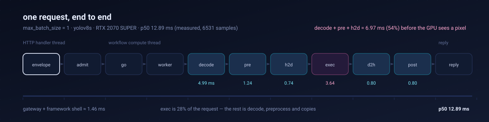

<div align="center">

<picture>
  <source media="(prefers-color-scheme: dark)" srcset="resources/readme/hero-dark.svg">
  
</picture>

[](https://github.com/MaybeShewill-CV/mortred_model_server/actions/workflows/ci.yml)


[English](README.md) · [中文](README.zh-cn.md) · [Deployment](docs/deployment.md) · [API contract](docs/api-contract.md)

</div>

**One catalog id is one OS process.** A model cannot take its neighbour down, its VRAM is
accounted for before it starts, and the same request envelope works across MNN, ONNX Runtime and
TensorRT. A supervisor owns the process tree; a gateway is the only public listener.

<div align="center">

| **44** HTTP model ids | **3** inference backends | **12.89 ms** p50, yolov8s end-to-end | **96/96** gate, no skips |
|:---:|:---:|:---:|:---:|

</div>

## How a request moves

<picture>
  <source media="(prefers-color-scheme: dark)" srcset="resources/readme/pipeline.svg">
  
</picture>

Every stage is instrumented (`stage_timing`); the numbers above are the p50 of a 6531-sample run,
not an estimate. The point is not that inference is fast — it is that **72% of an end-to-end
request is decode, preprocess and copies**, which is why the optimisation work targeted those
stages first. Iteration log: [docs/perf/latency_iterations.md](docs/perf/latency_iterations.md).

## Architecture

<picture>
  <source media="(prefers-color-scheme: dark)" srcset="resources/readme/architecture.svg">
  
</picture>

- **mortred-gateway** (`:8080`) — the only public listener: routing, bearer auth, GCRA rate limiting, `/metrics`.
- **mortred-supervisor** (`:8787`) — management API, restart policy, autostart, VRAM occupancy admission.
- **model processes** — one per catalog id, loopback only, holding exactly the workers you configured.

Two deployment profiles, one switch (build, dependencies, catalog and weights all follow it):

| | `gpu` (default) | `cpu` |
|---|---|---|
| backends | MNN-CUDA / ORT-CUDA / TensorRT | MNN-CPU / ORT-CPU |
| hardware | NVIDIA GPU + CUDA 12 / TensorRT 10 | any x64 machine |

## 60-second demo

```bash
docker compose --profile gpu up -d          # or --profile cpu
mortredctl next                             # tokens → loopback → start → verify
mortredctl doctor --strict                  # fail-closed on anything that would 401 later
```

One inference through the gateway:

```bash
set -a && . conf/local/trust.env && set +a
curl -s localhost:8080/v1/models/yolov8s/infer \
  -H "Authorization: Bearer $MORTRED_GATEWAY_AUTH_TOKEN" \
  -H "Content-Type: application/json" \
  -d "{\"images\":[\"$(base64 -w0 demo_data/model_test_input/mot/2.jpg)\"]}" | jq -c
```

```json
{"status":0,"status_str":"OK","task_id":"...","model":{"name":"yolov8s","version":""},
 "results":[{"status":0,"data":{"detections":[{"bbox":[x1,y1,x2,y2],"score":0.91,"class_id":0,"category":"person"}]}}],
 "server_time_ms":12.9,"partial":false}
```

The UI at `http://localhost:8787` renders the same process tree the supervisor owns. Other install
entries (bootstrap script, release tarball + systemd) are in [deployment.md](docs/deployment.md).

## Throughput

<picture>
  <source media="(prefers-color-scheme: dark)" srcset="resources/readme/benchmark.svg">
  
</picture>

All 39 product models, CPU and GPU, with p99: [docs/benchmark-set-a.md](docs/benchmark-set-a.md).
How many models fit on one card: [docs/capacity-single-gpu.md](docs/capacity-single-gpu.md).

## Model zoo

<picture>
  <source media="(prefers-color-scheme: dark)" srcset="resources/readme/model-zoo.svg">
  
</picture>

| Highlights | |
|---|---|
| Detection | yolov5l · yolov6s · yolov7 / 7x · yolov8 n/s/l/x · nanodet ×2 |
| Face | libface (YuNet) · centerface |
| Dense prediction | bisenetv2 · pphuman ×3 · hrnet · msocrnet · modnet · ppmatting ×4 |
| Enhancement | enlightengan · attentive-gan · real-esrgan |
| Feature / depth | superpoint · dinov2 ×3 · depth-anything ×3 · metric3d ×2 |
| Generative | SAM_AMG · DDPM · DDIM · CLS_COND_DDIM · LDM |
| Bench-only | CLIP · LightGlue · SAM predictor · FastSAM (no HTTP route) |

`mortred-model-server.out --list` is the authoritative list (ids match exactly; lowercase for the
CV families, uppercase for the diffusion rows). Weights are fetched, not committed:
`python3 scripts/fetch_weights.py` from
[Hugging Face](https://huggingface.co/MaybeShewill-CV/mortred_model_server).

## Operations

```bash
mortredctl status                 # process tree, states, restarts, pids
mortredctl doctor --strict        # config + tokens + engine + occupancy gates
curl -s localhost:8080/metrics -H "Authorization: Bearer $MORTRED_METRICS_TOKEN"
mortredctl upgrade                # release tarball → conf backup → restart → doctor
```

Supervisor and model logs land under `logs/`; the crash handler is always on, and
`MORTRED_CORE_DUMPS=1` adds core dumps on top.

## Build from source

```bash
sudo ./scripts/install_deps.sh --all         # CUDA 12 / TensorRT 10; --nvidia for driver bits
cmake --preset full && cmake --build --preset full
./scripts/verify_deployment.sh --basic
```

`tests-only` / `full-cpu` presets cover machines without a GPU; the default target is `check`
(unit + contract; e2e and stress run on their own lanes — the authoritative list of what `check`
does **not** run is [test/CHECK_SSOT.md](test/CHECK_SSOT.md)). The build is fail-closed on missing
workflow/crypto, wrong ORT headers or leftover TRT 8, and the error names the fix.

## Docs

| Start here | |
|---|---|
| [deployment.md](docs/deployment.md) | three install entries, systemd, docker, TRT engine regeneration |
| [api-contract.md](docs/api-contract.md) | request envelope, status codes, `/jobs`, `/metrics` |
| [model-developer-guide.md](docs/model-developer-guide.md) | add a model, contract tests, golden gate |
| [how_to_add_new_server.md](docs/how_to_add_new_server.md) | add a whole family |
| [tutorials_of_model_servers.md](docs/tutorials_of_model_servers.md) | per-family request/response walkthroughs |
| [about_model_server_configuration.md](docs/about_model_server_configuration.md) | every server knob explained |
| [unsupported-boundaries.md](docs/unsupported-boundaries.md) | what this project deliberately is not |
| [ci-golden-regression.md](docs/ci-golden-regression.md) | which gate runs where, and why |

## Contributing

Pull requests run the gates you can run locally: `cmake --build --preset tests-only-werror` plus
`python3 scripts/check_consistency.py`; GPU-touching changes also need the golden smoke on a CUDA
machine. Per-iteration measurements and design notes are expected to land in `docs/`.

## License

MIT — see [LICENSE](LICENSE). Standing on [MNN](https://github.com/alibaba/MNN), [ONNX Runtime](https://github.com/microsoft/onnxruntime), [TensorRT](https://developer.nvidia.com/tensorrt) and [workflow](https://github.com/sogou/workflow).

<div align="center"><sub>Built for the people who have to keep it running at 3 a.m.</sub></div>
